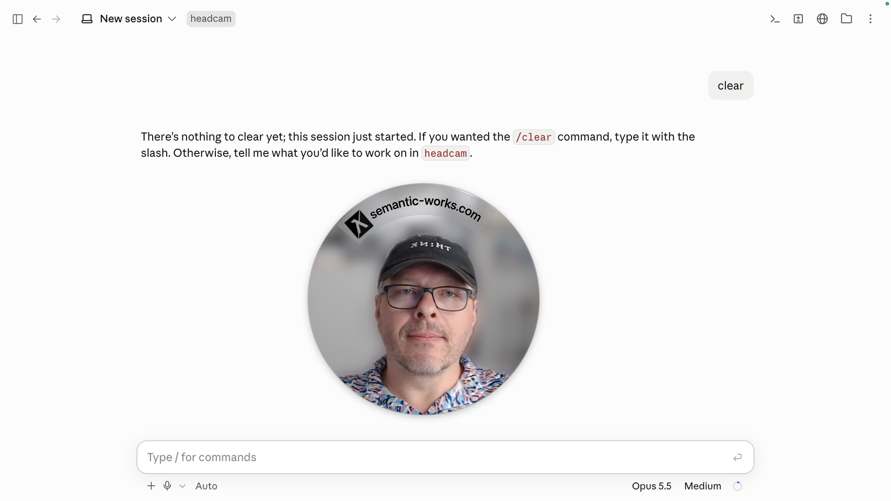
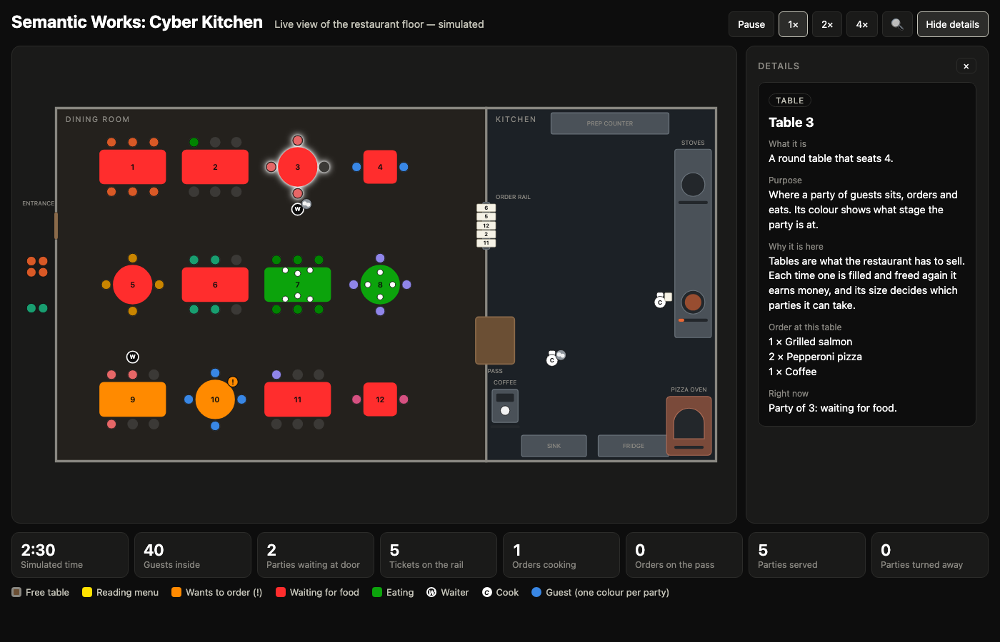
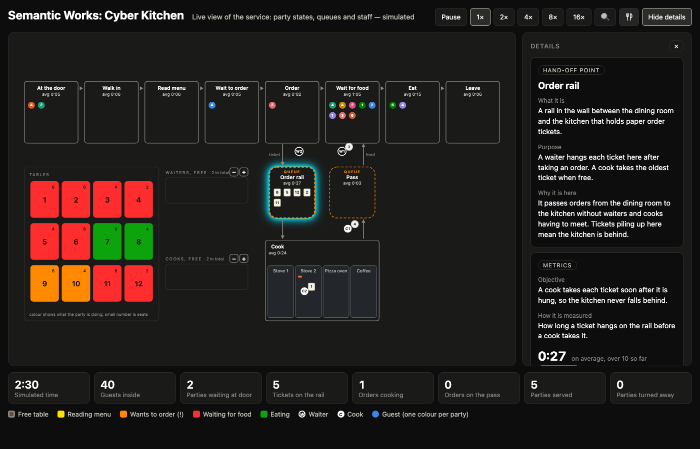
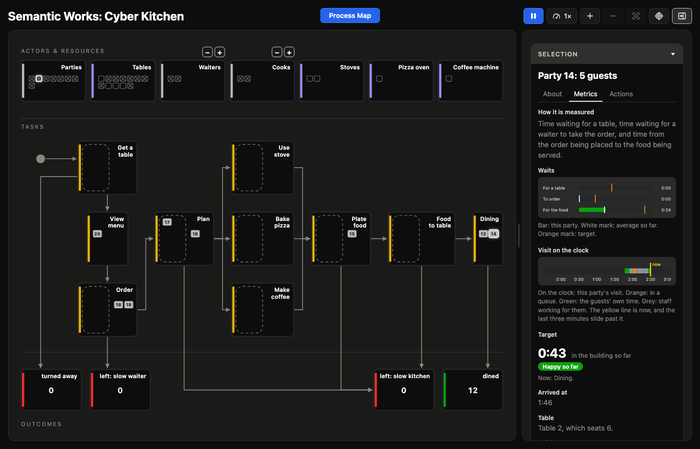
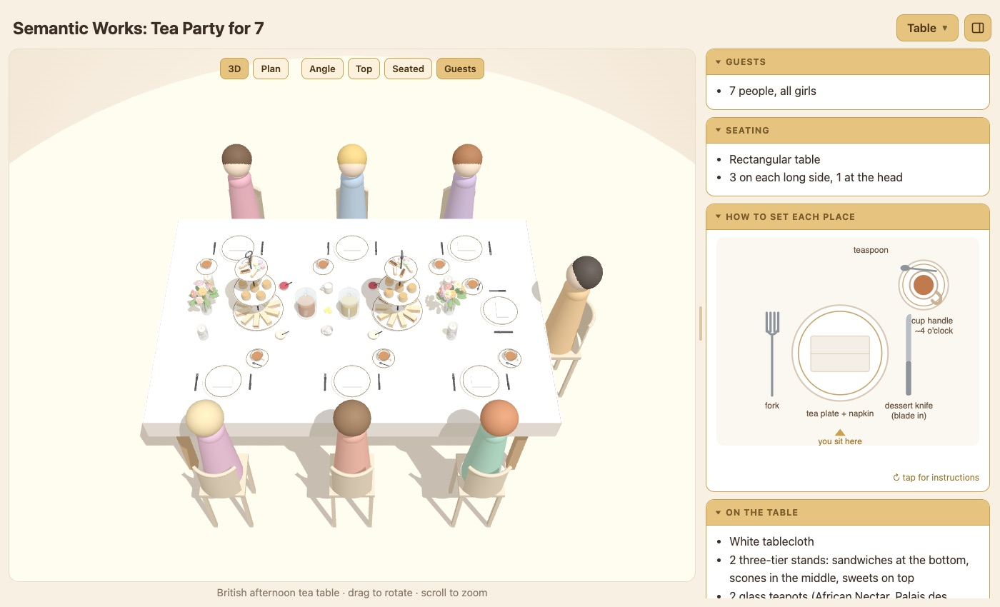
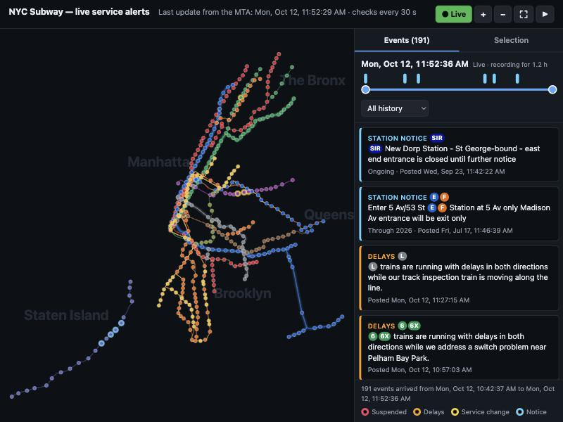
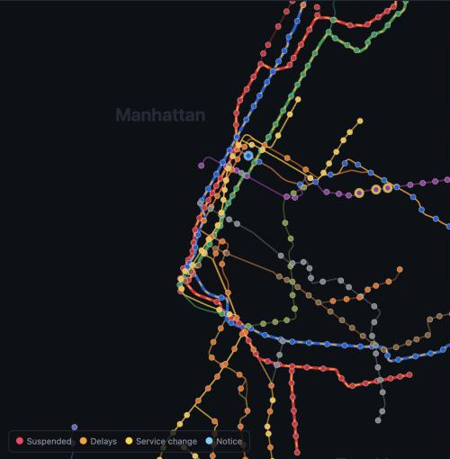

# Semantic Works — Public Projects

Public code, technical demonstrations, tutorials, and experiments from Semantic Works.

Projects explore practical software engineering, AI, intelligent systems, and simulation. Each project aims to make the approach understandable, the implementation inspectable, and the results reproducible.

Developed & maintained by Semantic Works LLC.

## Our Projects

### HeadCam Studio

A series building tools for narrating and recording on a Mac, starting with your own head on screen.

* **[Episode 1 (The Bubble Head)](./headcam-studio/episode-1/)** — A native macOS app that shows your webcam as a bubble floating above every app, so it appears in screen recordings and presentations. It can blur the room behind you or put a picture there, and shows a live transcript of what you say as you speak. Everything runs on the Mac, using only Apple's own frameworks.

The episode also includes a video of how the app was built: **[watch the video](https://semantic-works.com/public/headcam-studio/episode-1/video/)**, or [watch it on YouTube](https://youtu.be/ER1GQ6WiXwA).

[Explore the project](./headcam-studio/)

### Cyber Kitchen

A series exploring visual modeling, workflow graphs, and discrete-event simulation, using a restaurant as the subject. Each episode is built in one recorded conversation between a person and an AI model, and the full conversation is published with the code.

* **[Episode 1 (The Restaurant)](./cyber-kitchen/episode-1/)** — An animated, clickable floor plan of a restaurant: guests arrive, waiters take orders, cooks work through tickets, and every object on the floor can be inspected.
* **[Episode 2 (The Workflow)](./cyber-kitchen/episode-2/)** — A second view of the same simulation, as work flowing through steps and queues, with a measure and a target for everything on screen.
* **[Episode X (500 Million Tokens to Cook One Process Map)](./cyber-kitchen/episode-x/)** — The restaurant rebuilt on discrete-event simulation: one engine, three views (Floor Plan, Process Map, Scorecard), an objective and metrics for every object, actions such as calling a cook in sick, and a full test suite.

Each episode also includes a slide-by-slide presentation of how it was built, with the finished simulator running live on its third slide: follow the journey for **[Episode 1](https://semantic-works.com/public/cyber-kitchen/episode-1/journey/)**, **[Episode 2](https://semantic-works.com/public/cyber-kitchen/episode-2/journey/)** and **[Episode X](https://semantic-works.com/public/cyber-kitchen/episode-x/journey/)**.

| The restaurant floor | The service view | The Process Map |
|---|---|---|
|  |  |  |

[Explore the project](./cyber-kitchen/)

### Tea Time Planner

A series using AI to plan real occasions, by talking them through.

* **[Episode 1 (The Afternoon Tea)](./tea-time-planner/episode-1/)** — A planning app for a British afternoon tea for seven, built by voice in about an hour and a half while the party itself was being planned: a 3D table that turns by itself, a plate of finger sandwiches with recipe cards, a drinks table with steam and bubbles, and a day-by-day plan with a shopping list by store.

The episode also includes a slide-by-slide presentation of how the app was built, with the finished app running live on its third slide: **[follow the journey](https://semantic-works.com/public/tea-time-planner/episode-1/journey/)**.

[Explore the project](./tea-time-planner/)

### NYC Subway Live

A series building a live view of the New York subway from the MTA's public data. It is an experiment, not an official MTA or NYC Subway product, and should not be relied on for travel.

* **[Episode 1 (The Lines and Stations)](./nyc-subway-live/episode-1/)** — A map of all 29 lines and 496 stations that shows service alerts as the MTA publishes them, keeps a history of them, and lets you wind the clock back. Any station, line or event can be selected for its details. It uses no libraries, no API key and no account.

The episode also includes a slide-by-slide presentation of how the app was built, from the first error on screen to the finished map, with the app replaying a recorded afternoon of alerts on its third slide: **[follow the journey](https://semantic-works.com/public/nyc-subway-live/episode-1/journey/)**.

| Live alerts and the timeline | Zoomed in on Manhattan |
|---|---|
|  |  |

[Explore the project](./nyc-subway-live/)

## Why Semantic Works

Large language models are changing software development and reshaping the skills people need across business and everyday life.

As an advisor helping businesses adopt AI, I share practical examples of what is now possible with different LLMs and AI-powered tools. My goal is to help people discover new ways to work, solve problems, and improve their day-to-day lives.

This is for everyone: software engineers, analysts, business professionals, college students, retirees, and anyone curious about what these tools can do.

You don't need to be an AI expert or even a software engineer to benefit. I want to make these capabilities understandable, demonstrate them through real examples, and help more people put them to work in ways that matter to them.
